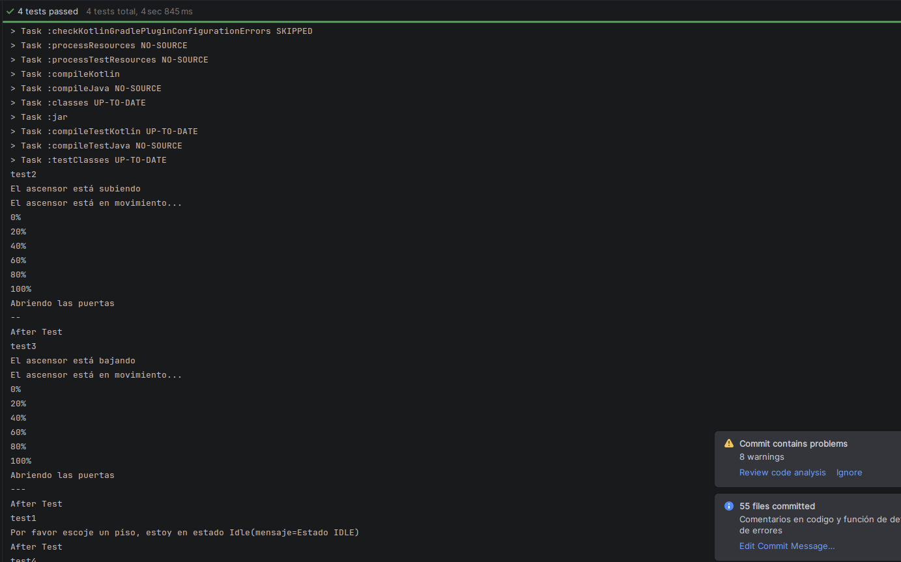

# Examen PMDM máquina de estados

## Alumno

- Anxo Vázquez Lorenzo

## Implementación

### Estados

Para los estados implemento una sealed class con varios data class dentro que vendrían siendo los diferentes estados del ascensor.

### Niveles

Para los niveles implemento un enum class con los diferentes niveles

### Gestor

Gestor es un objeto que contiene varios atributos y un método gestor que recibe dos botones (subir y bajar) y avanza por los estados con un when.

Adicionalmente tiene otros dos métodos, uno que simula el movimiento de los ascensores y otro que (en un caso real), leería los sensores del ascensor y devolvería true o false en función de si el ascensor está bien para así mandarlo al estado de error

### Test

Ejecutando los test:

